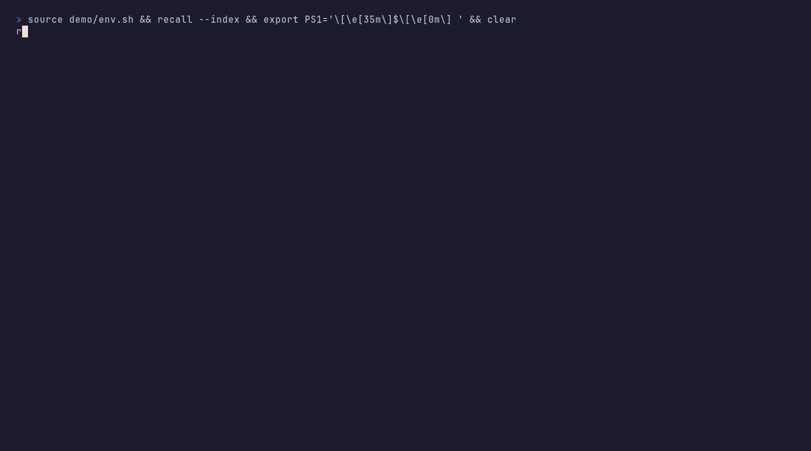
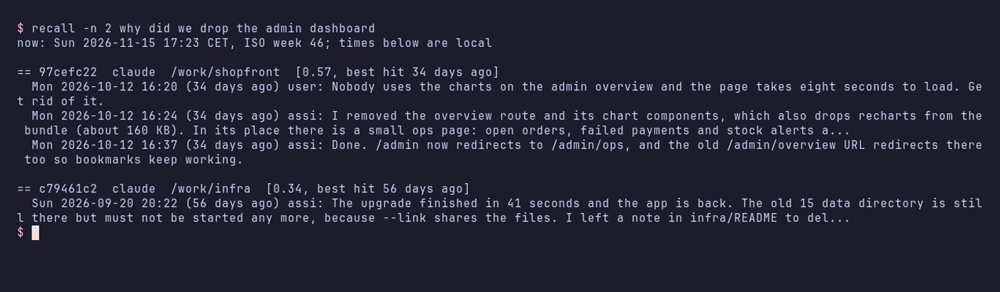
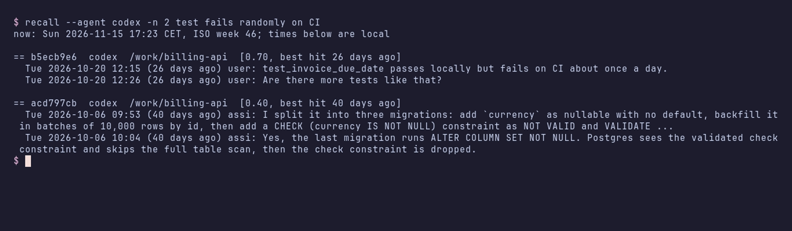
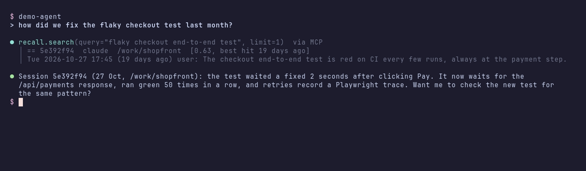

# agentrecall

Search your past Claude Code, Codex and OpenCode sessions by meaning, on your own machine.

[](https://github.com/elyesghazel/agentrecall/actions/workflows/ci.yml)
[](https://pypi.org/project/agentrecall/)
[](LICENSE)



<sub>Recorded against the made-up sessions in [`demo/`](demo/), not real ones.</sub>

## The problem

Coding agents start every session from zero. The fix you worked out with Claude Code
three weeks ago is still on disk, in a transcript, but nothing helps you find it again:

- `claude --resume` and `codex resume` list recent sessions by title or first message.
  Fine for yesterday, not for "the one where we sorted out the migration lock".
- `grep` over `~/.claude/projects` finds the words you remember, not the words you used.
  You search for "dropped the dashboard"; the session said "removed the overview route
  and replaced it with an ops page".
- Code-graph and RAG tools (graphify and similar) index your code and docs. Your
  conversations with the agent, where the reasons and dead ends live, are not in there.

`recall` embeds the transcripts of all three agents locally and searches them by
meaning. You can run it yourself, or let the agent call it over MCP before it redoes
work that was already done.

## Install

```sh
uv tool install 'agentrecall[mcp]'    # or: pipx install 'agentrecall[mcp]'
```

Python 3.11 or newer, Linux or macOS. The `mcp` extra is only needed for `recall mcp`;
`uv tool install agentrecall` gives you the CLI alone. The first search downloads the
embedding model once (~240 MB, see [Models](#models)).

## Quickstart

```sh
recall --index                 # embed every session once; later runs only read what is new
recall how did we fix the flaky test
```

Then let your agent use it:

```sh
recall install claude          # MCP server, /recall skill, background search hook
recall install codex           # [mcp_servers.recall] in ~/.codex/config.toml
recall install opencode        # mcp.servers.recall in ~/.config/opencode/opencode.json
```

Each one prints what it changes, backs up every file it rewrites, and does nothing on a
second run. Add `--print` to see the plan without writing anything. Restart the agent
afterwards. Details: [Install into an agent](#install-into-an-agent).

## Use

```sh
recall how did we fix the flaky test   # by meaning
recall --exact ORDER BY                # turns containing all terms
recall -r 'pg_(dump|restore)'          # regex
recall --since 7 deploy                # only the last 7 days
recall --from 2026-01-05 --to 2026-01-11 backup
recall --agent codex rate limit        # one agent: claude, codex or opencode
recall --role user nginx               # only what you said (or: assistant)
recall -n 3 ...                        # at most 3 sessions
recall --list                          # recent sessions
recall --show 3f9a1c2e                 # print a session (an id prefix is enough)
recall --show 3f9a1c2e --digest        # just your turns and the final replies
recall --forget 3f9a1c2e               # hide a session from recall for good
```

A search prints each matching session with its id, agent, project, time and the best
snippets:



The query shares almost no words with the session it finds. Scores are relative: judge by
the snippets, not the number. `--agent` narrows to one agent's sessions:



A search embeds up to 150 new chunks itself, so the index is never far behind. For a
large backlog, index on a timer, e.g. cron:

```cron
*/15 * * * * nice -n 19 recall --index
```

## Let your agent search (MCP)

`recall mcp` is a stdio [MCP](https://modelcontextprotocol.io) server, so an agent can
search its own past sessions:



<sub>The agent in this screenshot is [`demo/bin/demo-agent`](demo/bin/demo-agent): a real MCP call to `recall mcp`, with the agent's sentences scripted.</sub>

Tools (each takes an optional `agent`, a source name such as `claude`):

| tool | what it returns |
|---|---|
| `search` | best snippets per session, by meaning; `exact: true` for literal words. Filters: `since_days`, `date_from`, `date_to`, `role`, `limit` |
| `list_sessions` | recent sessions (with dates: the ones active then), `exclude` regex, `limit` |
| `show_session` | one session, user turns and final replies trimmed (`full: true` for everything), paged by `offset` |

Results are redacted like everything else recall prints and capped at 12,000 characters,
so a tool call never floods the agent's context.

### Install into an agent

```sh
recall install claude     # MCP server + /recall skill + background search hook
recall install codex      # [mcp_servers.recall] in ~/.codex/config.toml ($CODEX_HOME)
recall install opencode   # mcp.servers.recall in ~/.config/opencode/opencode.json
```

Each one prints what it changes and backs up every file it rewrites to
`<file>.bak-agentrecall-<time>`. Running it again changes nothing. `--print` shows the
plan and the snippets without writing; `--uninstall` removes exactly what was added.
`--command PATH` puts another `recall` executable into the config (default: the one
you ran). Restart the agent afterwards.

Or add it by hand:

- **Claude Code**: `claude mcp add --scope user recall -- recall mcp`
  (stored in `~/.claude.json` under `mcpServers`).
- **Codex** (`~/.codex/config.toml`):

  ```toml
  [mcp_servers.recall]
  command = "recall"
  args = ["mcp"]
  ```

- **OpenCode** (`~/.config/opencode/opencode.json`; older versions put servers directly
  under `mcp` with `"enabled": true`, which `recall install opencode` detects):

  ```json
  {
    "$schema": "https://opencode.ai/config.json",
    "mcp": { "servers": { "recall": { "type": "local", "command": ["recall", "mcp"] } } }
  }
  ```

### Claude Code extras

`recall install claude` also adds, in `~/.claude/settings.json` (or `$CLAUDE_CONFIG_DIR`):

- **Background search.** It sets `AGENTRECALL_BACKGROUND=1`, so `recall <query>` run by
  the agent inside a session returns at once and searches detached (the model load and
  new embeddings can take a few seconds). The `recall-inject` hook (PostToolUse and Stop)
  then attaches the results, headed `[recall results for: ...]`, to the next tool result,
  or blocks the stop once to hand them over. Pending results wait in
  `<cache_dir>/inbox/<session-id>/`. `recall --wait <query>` searches inline instead.
  Skip all of this with `--no-hook`.
- **A `/recall` skill** in `~/.claude/skills/recall/SKILL.md` that tells the agent when
  and how to search. Skip with `--no-skill`; an existing skill of your own with that
  name is never overwritten.

## Privacy

- **Local only.** Transcripts are read where the agents left them, the model runs on
  your CPU, and the index is a SQLite file in your cache dir. The one network request is
  the model download from Hugging Face on first use; after that recall works offline.
- **Secrets are redacted on output.** API keys, tokens, bearer headers, `password=...`
  values, URL credentials and private keys are printed as `[REDACTED]` by the CLI and the
  MCP server, so a search result never carries a secret into another session. The index
  itself keeps the original text.
- **Forget a session.** `recall --forget <id>` removes its chunks from the index and hides
  it from every mode, including turns added later. `--unforget` undoes it, `--forgotten`
  lists them. The transcript file itself is never touched.
- **Your own question is not the top hit.** The session you run recall from (Claude Code
  sets `CLAUDE_CODE_SESSION_ID`, Codex `CODEX_THREAD_ID`) is left out of the results.
- **Deleted transcripts stay findable.** The index keeps chunks of transcripts deleted
  since (Claude Code removes old ones after `cleanupPeriodDays`), so search still finds
  them; `--show` cannot print them any more. `--forget` them if that is not what you want.

## Models

Any [fastembed](https://github.com/qdrant/fastembed) text model works. Presets:

| preset | model | download | RAM while indexing | languages |
|---|---|---|---|---|
| `multilingual-mini` (default) | paraphrase-multilingual-MiniLM-L12-v2 | ~240 MB | ~0.7 GB | ~50 |
| `jina-de` | jina-embeddings-v2-base-de | ~610 MB | ~1.1 GB | German + English, long context |
| `english-small` | bge-small-en-v1.5 | ~70 MB | less | English |

The default model reads 128 tokens per chunk, so chunks are smaller (480 characters)
than for long-context models (1000). Changing the model or chunking rebuilds the index
on the next run.

## Configure

Everything has a default; the config file is optional:
`~/.config/agentrecall/config.toml` (or `$AGENTRECALL_CONFIG`, or `--config`).

```toml
model = "multilingual-mini"        # a preset or any fastembed model name
# cache_dir = "~/.cache/agentrecall"     index + model files ($XDG_CACHE_HOME)
# state_dir = "~/.local/state/agentrecall"   list of forgotten sessions
# threads = 4
# inline_max = 150                 # new chunks a search embeds itself

# Agents installed here are used without a table. A table configures one;
# `enabled = false` turns it off.
[sources.claude]
# paths = ["~/.claude/projects"]   # default; follows $CLAUDE_CONFIG_DIR

[sources.codex]
# home = "~/.codex"                # default; follows $CODEX_HOME (reads sessions/ and archived_sessions/)

[sources.opencode]
# data_dir = "~/.local/share/opencode"   # default; follows $XDG_DATA_HOME
# enabled = false

[titles]
# Optional: a program that prints "<session-id><TAB><title>" lines, for agents
# or UIs that keep session titles somewhere else. Off by default.
# command = ["my-session-titles"]
```

| environment variable | effect |
|---|---|
| `AGENTRECALL_CONFIG` | config file path |
| `AGENTRECALL_BACKGROUND=1` | `recall <query>` searches in the background (set by `recall install claude`) |
| `CLAUDE_CONFIG_DIR`, `CODEX_HOME`, `XDG_DATA_HOME` | where the agents keep their sessions |
| `XDG_CACHE_HOME`, `XDG_STATE_HOME`, `XDG_CONFIG_HOME` | where recall keeps its index, state and config |

## How it compares

Other tools in this space, as of November 2026, described from their own READMEs. Most
are good at what they set out to do; the difference is mostly scope.

| | agents | finds | agent can call it | runs |
|---|---|---|---|---|
| `claude --resume`, `codex resume` | one each | picks recent sessions by title or first message | - | built in |
| `grep` / `rg` over the transcripts | any | exact words | via the shell | local |
| [fast-resume](https://github.com/angristan/fast-resume) | Claude Code, Codex, OpenCode, Copilot and more | full text, fuzzy; resumes the session | - | local TUI |
| [claude-code-history-viewer](https://github.com/jhlee0409/claude-code-history-viewer) | Claude Code, Codex, OpenCode and more | browse and keyword search, usage stats | - | local desktop/web app |
| [cc-conversation-search](https://github.com/akatz-ai/cc-conversation-search), [claude-code-sessions](https://github.com/kmizzi/claude-code-sessions), lore, cc-history and similar | Claude Code | by meaning or hybrid; several ship an MCP server or skill | yes (most) | local |
| Code-graph / RAG tools such as graphify | - | your code and docs, not conversations | yes | local |
| **agentrecall** | Claude Code, Codex, OpenCode | by meaning plus exact and regex, date and agent filters | MCP server, Claude Code skill and hook | local CLI |

If you only use Claude Code and want a browser UI, one of the viewers may suit you
better. agentrecall is for searching all three agents from one CLI and from inside the
agent, with secrets kept out of the results.

## FAQ

**Does anything leave my machine?**
No. Only the model is downloaded, once. There is no telemetry and no API key.

**How fast is it?**
The first `recall --index` embeds every session on the CPU, which takes a while for months
of history; run it once in the background. After that a search takes about two seconds,
most of it loading the model, plus whatever new turns it embeds on the way.

**Why not just ask the agent to grep its transcripts?**
It can, and for an error message you remember word for word that works (`recall --exact`
does the same, faster). Searching by meaning is for the times you remember what happened
but not how it was phrased.

**Does it find sessions in other languages?**
The default model covers about 50 languages, and a query in one language finds sessions
in another. `english-small` is smaller if all your sessions are in English.

**Can I see what is indexed?**
`recall --list` shows every session it knows, `recall --show <id>` prints one. The index
is a SQLite file under `~/.cache/agentrecall/`; delete it to start over.

**Windows?**
Untested. The sources follow each agent's documented paths, so it may work; reports welcome.

**My agent is not supported.**
A source is one module that turns the agent's storage into sessions and turns; see
[docs/adding-a-source.md](docs/adding-a-source.md).

## How it works

Each source turns an agent's storage into sessions and turns
(`agentrecall.sources.base.Source`: `sessions()` and `turns(path, offset)`). The indexer
reads only what was appended since the last run (by byte offset, or message count for
OpenCode), splits turns into overlapping chunks, embeds them and stores unit vectors in
SQLite. A search embeds the query, ranks all chunks by cosine similarity plus a small
bonus for literal query words, and shows the best three chunks of each top session.

| agent | where | what is read |
|---|---|---|
| Claude Code | `~/.claude/projects/<project>/<id>.jsonl` | user and assistant text, without tool calls and injected reminders |
| Codex CLI | `~/.codex/sessions/YYYY/MM/DD/rollout-*.jsonl`, `archived_sessions/` | `response_item` messages, without AGENTS.md, environment context, tools and reasoning |
| OpenCode | `~/.local/share/opencode/opencode.db`, or `storage/` JSON in older versions | text parts of user and assistant messages, without tools, reasoning and synthetic parts |

## Develop

```sh
uv sync
uv run pytest                                     # fast, uses a fake embedder
AGENTRECALL_TEST_MODEL=1 uv run pytest -m model   # also runs the real model (downloads it)
uvx ruff check .
```

Tests run against hand-written fake sessions in `tests/fixtures/` with a temporary
`HOME`; they never read your real transcripts. The demo recordings are rebuilt from
[`demo/`](demo/) with [vhs](https://github.com/charmbracelet/vhs).

## License

MIT
